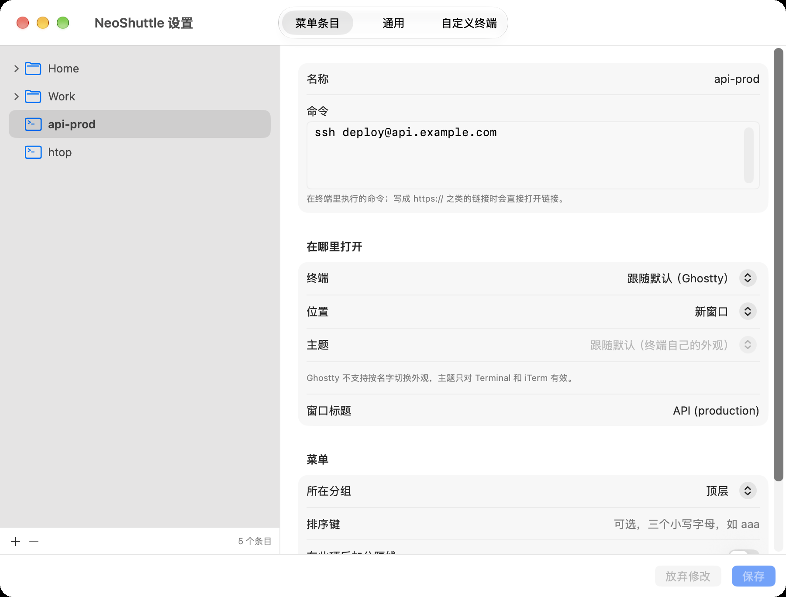

<p align="center">
  
</p>

<h1 align="center">NeoShuttle</h1>

<p align="center"><strong>从菜单栏一键打开你的服务器和常用命令。</strong></p>

<p align="center">
  原生重写的 <a href="https://github.com/fitztrev/shuttle">Shuttle</a>：沿用 <code>~/.shuttle.json</code>，<br>
  支持 Ghostty、Seedmux、Warp、kitty、WezTerm 等终端，并提供图形设置界面。
</p>

<p align="center">
  
  
  
  
</p>

<p align="center">
  <a href="https://github.com/shaun17/NeoShuttle/releases/latest">下载</a> ·
  <a href="#快速开始">快速开始</a> ·
  <a href="#配置参考">配置参考</a> ·
  <a href="#从源码构建">从源码构建</a>
</p>

## NeoShuttle 是什么？

NeoShuttle 是一个 macOS 菜单栏工具。你把常用的 SSH 登录、脚本和命令写进配置，它们就会出现在菜单栏的下拉菜单里，按分组排列；点一下，命令就在你选定的终端里执行，可以开新窗口、新标签页或分屏。

它是对 [fitztrev/shuttle](https://github.com/fitztrev/shuttle) 的原生重写。原版已多年未更新，只有 Intel 版本，只支持 Terminal 和 iTerm。NeoShuttle 原样读取原来的配置文件，换过来不需要改任何东西。

<p align="center">
  
</p>

## 功能

- **兼容原版配置**：直接读取 `~/.shuttle.json`，分组、排序前缀 `[aaa]`、分隔线 `[---]`、`~/.shuttle.path`、`~/.shuttle-alt.json` 的行为都和原版一致。
- **8 种内置终端**：Terminal、iTerm、Ghostty、Seedmux、Warp、kitty、WezTerm、Alacritty。其他终端可以用启动模板或模拟按键接入。
- **按条目指定打开方式**：每个条目可以单独选择终端，以及新窗口、新标签页、当前窗口或分屏。
- **图形设置界面**：在树状列表里管理条目和分组，表单编辑，未保存的修改也能先“运行测试”。保存时会保留配置文件里界面不认识的字段。
- **SSH 主机**：可以把 `~/.ssh/config` 里的主机合并进菜单，在设置里查看连接信息、隐藏不需要的主机。
- **Apple Silicon 原生**：通用二进制，不需要 Rosetta。
- **菜单栏常驻**：平时只在菜单栏，也可以设置在 Dock 中常驻。

## 安装

1. 从 [Releases](https://github.com/shaun17/NeoShuttle/releases/latest) 下载最新的 `NeoShuttle-<版本>.dmg`。
2. 打开 DMG，把 NeoShuttle 拖到“应用程序”。
3. 启动 NeoShuttle，菜单栏会出现火箭图标。

发布的 DMG 都经过 Developer ID 签名和 Apple 公证，双击即可打开。需要 macOS 14 或更高版本。

## 快速开始

1. 点菜单栏的火箭图标。如果还没有 `~/.shuttle.json`，NeoShuttle 会生成一份示例；已有的文件不会被改动。
2. 选择 **设置…**（⌘,），在 **菜单条目** 里点左下角的 **+** 新建条目，填入名称和命令，比如 `ssh user@example.com`。
3. 在 **通用** 里选择默认终端和打开位置，然后点 **保存**。
4. 回到菜单栏点击条目，命令就会在终端里执行。

第一次控制某个终端时，macOS 会请求权限，详见下方[权限](#权限)。

## 设置窗口

设置窗口分三页，所有修改点 **保存**（⌘S）后才写入文件，**放弃修改** 可以撤销。

| 页面 | 内容 |
|---|---|
| 菜单条目 | 树状列表与菜单顺序一致（分组在前、按名称排序）。可以编辑名称、命令、终端、位置、主题、窗口标题、所在分组、排序键和分隔线；右键运行、复制、移动或删除。`~/.ssh/config` 的主机以只读方式显示。 |
| 通用 | 默认终端、打开位置和主题；配置文件与编辑器；SSH 主机的开关、列表和忽略规则；登录时启动、Dock 常驻图标。 |
| 自定义终端 | 新建并测试自定义终端。改名时，引用它的条目会一起更新。 |

保存时的保护措施：

- 每次打开窗口后第一次保存前，会把原文件备份为 `~/.shuttle.json.bak`。
- 文件在其他地方被改过时，保存前会先询问。
- 文件无法解析时，界面不允许编辑，避免覆盖原文件。
- 保存会重新排版文件，JSON5 的 `//` 注释不会保留。

## 配置参考

配置文件默认是 `~/.shuttle.json`。每次打开菜单都会重新读取，改完不需要重启；配置有问题时，菜单顶部会显示 ⚠️ 提示。

```json
{
  "terminal": "Ghostty",
  "open_in": "tab",
  "default_theme": "",
  "editor": "default",
  "show_ssh_config_hosts": true,
  "hosts": [
    {
      "Work": [
        { "name": "db-primary", "cmd": "ssh db-primary" },
        { "name": "staging", "cmd": "ssh staging", "inTerminal": "split" }
      ]
    },
    { "name": "api-prod", "cmd": "ssh deploy@api.example.com", "terminal": "iTerm", "inTerminal": "new" },
    { "name": "Docs", "cmd": "https://github.com/shaun17/NeoShuttle" }
  ]
}
```

| 键 | 取值 | 说明 |
|---|---|---|
| `terminal` | 终端名 | 默认终端。可写内置终端名（大小写和 `.app` 后缀都可省略），也可写 `custom_terminals` 里的名字。 |
| `open_in` | `tab` / `new` | 默认打开位置。 |
| `default_theme` | 描述文件名 | 默认外观，只对 Terminal 的描述文件和 iTerm 的 Profile 有效。 |
| `editor` | `default` / 应用名 / 命令 | “编辑…”用什么打开配置文件：`default` 跟随系统默认应用，`Zed`、`Cursor` 等应用名直接用该应用，`vi`、`nano` 在终端里打开。 |
| `show_ssh_config_hosts` | `true` / `false` | 是否合并 `~/.ssh/config` 的主机。 |
| `ssh_config_ignore_hosts` | 字符串数组 | 不显示的主机（完全匹配）。 |
| `ssh_config_ignore_keywords` | 字符串数组 | 名字包含这些词的主机不显示。 |
| `custom_terminals` | 对象 | 见[自定义终端](#自定义终端)。 |
| `hosts` | 数组 | 菜单内容。`{ "分组名": [...] }` 是分组，可以嵌套。 |

条目字段：

| 键 | 说明 |
|---|---|
| `name` | 菜单里显示的名字。`[abc]` 前缀用于排序且不显示，`[---]` 会在该项后加一条分隔线。 |
| `cmd` | 要执行的命令。写成 `https://…` 这类链接时会直接打开链接。 |
| `terminal` | 只对这个条目生效的终端，覆盖默认终端。 |
| `inTerminal` | `new` / `tab` / `current` / `split`，只对这个条目生效。 |
| `theme` / `title` | 外观和窗口标题。 |

条目上的 `terminal` 和 `inTerminal` 优先于全局默认。有条目单独设置了位置时，**通用** 页会提示，并可以一键改回跟随默认。

### SSH 主机

打开 `show_ssh_config_hosts` 后，`~/.ssh/config`（包括 `Include` 引入的文件）中的每个 `Host` 都会成为一个执行 `ssh <Host>` 的条目。`Host *` 这类通配规则和以 `.` 开头的名字会被跳过。名字里的 `/` 会变成子菜单；想只改菜单里显示的名字，可以在 `Host` 下一行写：

```
Host db1
    HostName 10.0.0.12
    # shuttle.name Work/数据库
```

## 支持的终端

| 终端 | 方式 | 新窗口 | 新标签页 | 当前窗口 | 分屏 |
|---|---|---|---|---|---|
| Terminal | AppleScript | ✓ | ✓ ¹ | ✓ | 同新标签页 |
| iTerm | AppleScript | ✓ | ✓ | ✓ | ✓ |
| Ghostty 1.3+ | AppleScript | ✓ | ✓ | ✓ | ✓ |
| Seedmux | 本地控制接口 | 新页签 | ✓ ¹ | ✓ | ✓ |
| Warp | Launch Configuration | ✓ | 新窗口 | 新窗口 | 新窗口 |
| kitty | `kitty @` 远程控制 ² | ✓ | ✓ | ✓ | ✓ |
| WezTerm | `wezterm cli` | ✓ | ✓ | ✓ | ✓ |
| Alacritty | `alacritty msg` | ✓ | 新窗口 | 新窗口 | 新窗口 |

¹ 通过模拟 ⌘T 实现，需要“辅助功能”权限；没有权限时，Terminal 退回为新窗口，Seedmux 退回为分屏。
² 需要在 `kitty.conf` 中开启 `allow_remote_control` 和 `listen_on`，否则每次都开新窗口。

kitty、WezTerm 和 Alacritty 以“登录 shell 执行命令，结束后留在 shell 里”的方式启动，和在终端里直接输入命令的效果一致。

### 自定义终端

没有内置支持的终端，可以在 `custom_terminals` 中定义，然后像内置终端一样在 `terminal` 中引用：

```json
"custom_terminals": {
  "Rio":   { "launch": "open -na Rio --args -e /bin/zsh -lic {cmd}" },
  "Hyper": { "app": "Hyper", "keystroke": true, "delay": 1.0 }
}
```

- **`launch`**：在登录 shell 中执行的启动命令。`{cmd}` 和 `{title}` 会被替换成加好引号的参数，模板里不要再给它们加引号。
- **`keystroke`**：用于完全没有接口的终端。NeoShuttle 会把 `app` 切到前台，按 ⌘N 或 ⌘T，等待 `delay` 秒后输入命令并回车。需要“辅助功能”权限；等待期间焦点被切走时会放弃发送。

自定义终端与内置终端同名时，优先使用自定义的定义。

## 权限

| 权限 | 什么时候需要 | 在哪里打开 |
|---|---|---|
| 自动化 | 控制 Terminal、iTerm、Ghostty 执行命令 | 系统设置 › 隐私与安全性 › 自动化 |
| 辅助功能 | Terminal、Seedmux 的新标签页，以及模拟按键的自定义终端 | 系统设置 › 隐私与安全性 › 辅助功能 |

NeoShuttle 不访问外部网络（只在连接 Seedmux 时使用本机的控制接口），也不收集任何数据。

## 从源码构建

需要 Xcode 和 [XcodeGen](https://github.com/yonaskolb/XcodeGen)（`brew install xcodegen`）。工程文件由 XcodeGen 根据 `project.yml` 生成，不放在仓库里。

```sh
git clone https://github.com/shaun17/NeoShuttle.git
cd NeoShuttle
xcodegen generate
open NeoShuttle.xcodeproj
```

### 签名

默认使用临时签名（ad-hoc），不需要开发者账号就能构建运行。但临时签名每次构建都会变化，macOS 会反复请求“自动化”和“辅助功能”权限。使用自己的证书可以避免这个问题：

```sh
cp Config/Signing.local.xcconfig.example Config/Signing.local.xcconfig
# 填入 Team ID 和 Bundle ID 前缀；这个文件不会被提交
```

### 测试

```sh
xcodebuild -project NeoShuttle.xcodeproj -scheme NeoShuttle test
```

`NeoShuttleCore` 包含全部纯逻辑（配置解析与写回、ssh_config、转义与模板、提示符识别），由单元测试覆盖；`NeoShuttle` 是菜单栏应用、设置界面和各终端的启动器。

### 打包 DMG

```sh
Scripts/build_dmg.sh
```

在 `dist/` 生成 `NeoShuttle-<版本>-development.dmg` 和 `.sha256`，适合安装在自己的 Mac 上。发布给别人使用时，需要 Developer ID 证书和 `notarytool` 的钥匙串配置：

```sh
RELEASE_MODE=developer-id NOTARY_KEYCHAIN_PROFILE=<配置名> Scripts/build_dmg.sh
```

脚本会签名、提交 Apple 公证并附加公证票据，任何一步失败都会终止。

### 图标

App 图标和菜单栏图标由 `Branding/` 中的源图生成：

```sh
python3 Scripts/make-app-icon.py         # 需要 Pillow、numpy
python3 Scripts/make-menu-bar-icon.py    # 需要 Pillow
```

## 当前限制

- Ghostty、Seedmux 等终端不支持按名字切换外观，`theme` 只对 Terminal 和 iTerm 有效。
- Seedmux 没有公开的外部接口，NeoShuttle 使用它为 agent 协作提供的本地控制接口；Seedmux 更新后，这部分可能需要跟着调整。
- Warp 只能通过 Launch Configuration 执行命令，因此总是开新窗口。
- 通过设置界面保存会重新排版配置文件，JSON5 注释不会保留。

## 致谢

灵感和配置格式来自 Trevor Fitzgerald 的 [Shuttle](https://github.com/fitztrev/shuttle)。

## 许可证

[MIT](LICENSE)
